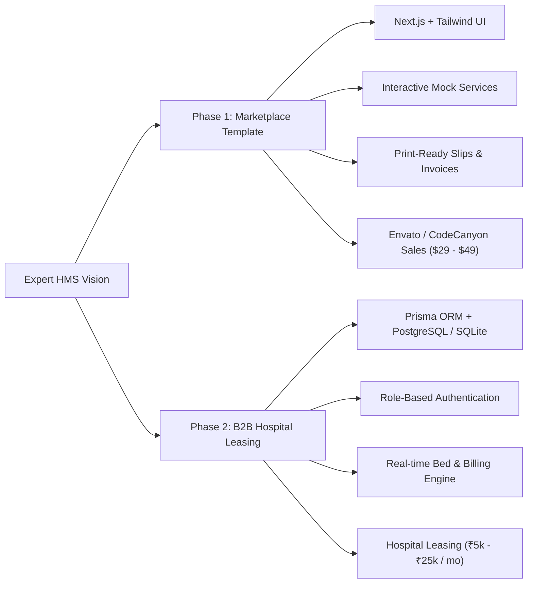
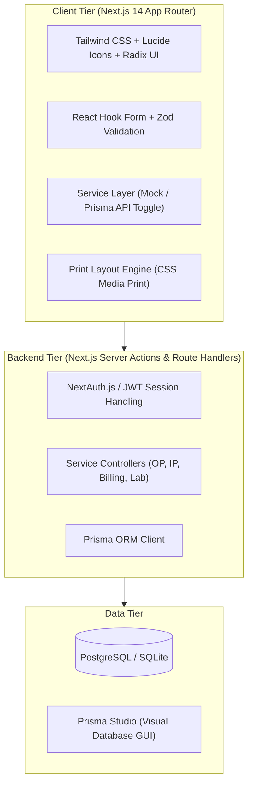
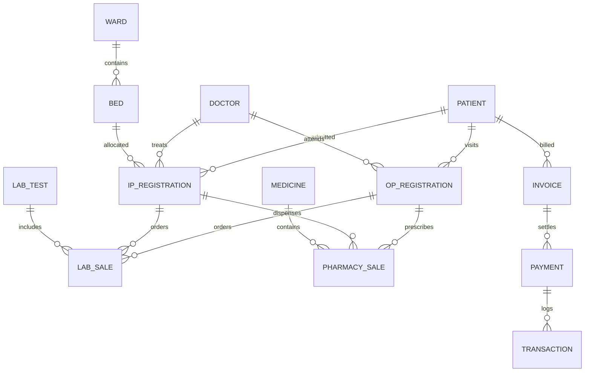
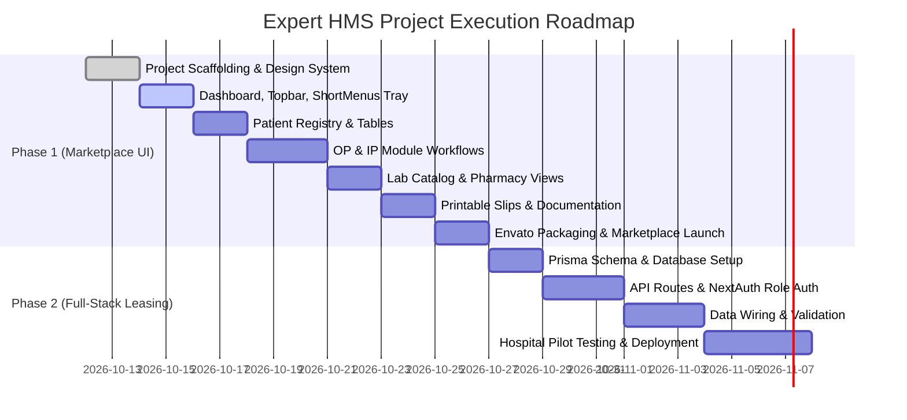

# Business Requirements Document (BRD)
## Project: Expert HMS (Modern Hospital Management & Clinical Operations Platform)

**Document Version:** 1.0  
**Status:** Approved for Implementation  
**Target Architecture:** Next.js (App Router), Tailwind CSS, TypeScript, Prisma ORM  
**Target Markets:** 
1. **Phase 1:** Commercial UI / SaaS Dashboard Template (Envato, ThemeForest, CodeCanyon, UI8)
2. **Phase 2:** Cloud / On-Premise B2B Healthcare SaaS (Leasing to Clinics, Nursing Homes & Hospitals)

---

## 1. Executive Summary

### 1.1 Project Purpose
Expert HMS is a modern, responsive, end-to-end Hospital Management System designed to streamline clinical workflows, patient administration, outpatient/inpatient operations, laboratory investigations, pharmacy inventory, and medical billing.

### 1.2 Dual-Phase Commercial Strategy

1. **Phase 1 (Monetization & Brand Building):** Deliver a premium, production-grade Next.js + Tailwind CSS template. Marketed to developers, digital agencies, and healthcare IT contractors looking for a ready-to-deploy medical dashboard.
2. **Phase 2 (Recurring SaaS & Local B2B Leasing):** Activate the Prisma ORM database layer and API routes to lease the software directly to 10–50 bed nursing homes, diagnostic clinics, and hospitals on a monthly subscription or annual maintenance contract (AMC).

---

## 2. User Personas & Role-Based Access Control (RBAC)

| Role | Primary Responsibilities | Key System Access |
| :--- | :--- | :--- |
| **Super Admin / Hospital Owner** | Overall administration, financial oversight, staff master, hospital branding & system settings. | Full system access, audit logs, revenue analytics, master rates. |
| **Front Desk / Receptionist** | Patient registrations, generating OP slips, collecting consultation fees, directing patients. | Patient registry, OP creation, ShortMenus, basic receipts. |
| **Consultant Doctor** | Outpatient consultations, writing clinical notes, prescribing lab tests & medicines, admitting to IP. | OP/IP records, patient clinical history, diagnostic requests. |
| **IP / Ward Nurse** | Monitoring admitted patients, tracking bed occupancy, daily nursing notes, discharge preparation. | IP records, Ward & Bed management, vitals tracking. |
| **Laboratory Pathologist / Tech** | Conducting diagnostic tests, entering lab values, validating results, managing test templates. | Manage Laboratory, Lab Test Catalog, Patient Test Records. |
| **Pharmacist** | Dispensing prescribed drugs, managing batch inventory, tracking expiry dates, OTC retail sales. | Pharmacy Sales, Stock Inventory, Rack Management, Suppliers. |
| **Billing / Cashier** | Advance payments, final IP settlement, insurance claims, receipts and expense entries. | Accounts, Advance Payment, Final Bill, Settlements. |

---

## 3. System Architecture & Tech Stack

### Stack Justification (Why 100% TypeScript?):
- **Single Language Ecosystem:** Frontend, backend APIs, types, and database queries are unified under TypeScript. Eliminates context-switching and makes custom changes straightforward without learning Python/Django.
- **Prisma Studio:** Zero-code visual database administration tool (`npx prisma studio`) allows the product owner or hospital admin to browse, search, and edit database records in a spreadsheet-style interface.
- **Zero-Friction Deployment:** One-click deployment to Vercel, Railway, Render, or any standard Linux/Windows hospital server.

---

## 4. Functional Requirements Specification

### Module 1: Dashboard & Navigation Hub
- **KPI Summary Cards (Gradient Styling):**
  - Today OP count & revenue
  - Today IP count & revenue
  - Laboratory sales total
  - Pharmacy sales total
  - Bed Occupancy count
  - Bed Available count
- **12 Main Category Tiles:**
  - Patient List, OP, IP, Laboratories, Pharmacy, Doctors, Wards, Manage Reports, Other Services, Admin Settings, Accounts, Settings.
- **ShortMenus Quick-Action Tray:**
  - Modal with 9 instant shortcuts: *Create New OP*, *Create New IP*, *Lab Billing*, *Pharmacy Billing*, *Other Services*, *Add Expenses*, *Emergency Services*, *Advance Payment*, *Bill Settlements*.

### Module 2: Master Patient Management
- **Unique Identification:** Auto-generated Medical Record ID (MR ID).
- **Patient Attributes:** Full Name, Age, Gender, Mobile Number, Guardian Name, Address, Blood Group, Active/Inactive status.
- **Interactive Patient Records Table:** Real-time search, sorting, pagination.
- **Context Actions:**
  - View Patient OP History
  - View Patient IP History
  - Edit Patient Demographics
  - Instant Consultations dropdown (`+ Create New OP`, `+ Create New IP`)

### Module 3: Outpatient (OP) Module
- **Registration Flow:**
  - Patient lookup or quick inline registration.
  - Doctor assignment and department selection.
  - Consultation fee calculation and payment status.
  - Generation of unique OP ID (e.g. `OP0304253457`).
- **Views:**
  - *Today OP Registrations* (daily operational queue).
  - *All OP Registration Records* (historical registry with date filters).
- **OP Action Dropdown:**
  - Print OP Token / Slip
  - Print Bill Receipt
  - Print OPD Letterpad (for doctor's handwritten notes)
  - Edit OP details / Cancel visit
- **Direct Cross-Billing Actions:**
  - From any OP record, directly initiate: *Lab Billing*, *Pharmacy Billing*, *Radiology*, *Advance Payment*, or *Convert to IP*.

### Module 4: Inpatient (IP) & Bed Management
- **Admission Flow:**
  - Inpatient ID generation (e.g. `IP010325499`).
  - Assigned Doctor, Admitting Nurse, Ward selection, and Bed allocation.
  - Reason for admission, provisional diagnosis, advance deposit intake.
- **Patient Tracking:**
  - Tabbed filtering: `ACTIVE PATIENTS` vs `DISCHARGED PATIENTS`.
- **Bed Management:**
  - Real-time visualization of beds (Occupied, Available, Maintenance, Cleaning).
- **Medical Certificates & Reports Engine:**
  - Discharge Summary generator
  - Final IP Bill with consolidated line items
  - Emergency Certificate
  - Medical / Fitness Certificate
  - Essentiality Certificate
  - LAMA (Left Against Medical Advice) Certificate
  - Death Certificate & Birth Certificate
  - Patient Surgery Record

### Module 5: Laboratory Management
- **Lab Dashboard Hub:**
  1. *Lab Tests Master Catalog* (Tests, codes, reference ranges, standard amounts).
  2. *Lab Test Templates* (Pre-formatted report templates).
  3. *Patient Test Records* (Pending, in-progress, completed test results).
  4. *Lab Sales Records* (Financial tracking of diagnostics).
- **Test Catalog Management:**
  - Add / Edit / Remove test types with Department, Test Name, Code, and Amount (e.g., AMH, CBP, Dengue Profile, Electrolytes, Lipid Profile, etc.).
- **Diagnostic Result Entry:**
  - Quantitative and qualitative parameter values, standard reference ranges, and pathologist sign-off.

### Module 6: Pharmacy & Stock Inventory
- **Point of Sale (POS):**
  - Dispense by Prescription or OTC Walk-in.
  - Batch selection with auto-FIFO (First Expiring, First Out).
- **Inventory Management:**
  - Stock receipt from Agencies / Distributors.
  - Rack Management (locating medicines by shelf/rack ID).
  - Expiry Date Tracking (amber alert for 90 days, red alert for expired).
  - Reorder Level Alerts for out-of-stock items.
  - Purchase Return and Sales Return registers.

### Module 7: Accounts, Billing & Settlements
- **Consolidated Patient Invoicing:**
  - Aggregation of Bed Charges + Doctor Consultations + Lab Investigations + Pharmacy Prescriptions + Nursing Charges.
- **Advance Payment System:**
  - Track multiple advance deposits against an active IP admission.
- **Bill Settlement:**
  - Real-time calculation of Total Bill, Total Advance Paid, Concessions/Discounts, and Balance Due.
  - Payment modes: Cash, Card, UPI, Insurance / TPA.

---

## 5. Print Specifications (Essential Healthcare Deliverables)

The application must include native, clean, CSS-print-styled documents that print seamlessly onto standard A4 and thermal receipt paper:

1. **OP Registration Slip / Token:** Hospital header, date/time, token number, patient MR ID, doctor name, fee receipt barcode.
2. **Doctor OPD Prescription Letterhead:** Patient vitals banner on top, blank or pre-structured prescription pad with doctor credentials and signature line.
3. **Inpatient Final Bill:** Itemized tabular breakdown with department sub-totals, advance payments deducted, net payable amount, and cashier signature.
4. **Discharge Summary:** Detailed clinical notes, admission date, discharge date, final diagnosis, treatment given, condition at discharge, and follow-up advice.
5. **Laboratory Diagnostic Report:** Parameter name, observed value, normal biological reference interval, units, and pathologist verification stamp.

---

## 6. Entity Relationship Model (ER Schema)

---

## 7. Phased Implementation Roadmap

### Phase 1 Milestones (Frontend Marketplace Launch):
- **Milestone 1.1:** Next.js project scaffolded with Tailwind CSS, custom color palette, and Lucide icons.
- **Milestone 1.2:** Dashboard shell completed with responsive navigation, gradient KPI cards, 12 core tiles, and ShortMenus modal.
- **Milestone 1.3:** Interactive Patient Registry and Outpatient (OP) workflow with functional action dropdowns.
- **Milestone 1.4:** Inpatient (IP) workflow with active/discharged filters, Bed allocation table, and Lab test management catalog.
- **Milestone 1.5:** Printable CSS layouts for OP token, Doctor prescription pad, IP bill, and Lab report.
- **Milestone 1.6:** Clean documentation (`README.md`, setup guide, customizable config file) ready for Envato / CodeCanyon submission.

### Phase 2 Milestones (Full-Stack SaaS Leasing):
- **Milestone 2.1:** Prisma ORM schema generated and SQLite/PostgreSQL migrations verified.
- **Milestone 2.2:** NextAuth.js authentication configured with Role-Based Access Control (Admin, Doctor, Reception, Lab, Pharmacy).
- **Milestone 2.3:** CRUD API routes connected to the existing frontend service layer.
- **Milestone 2.4:** On-premise installation package / Docker container ready for local hospital client lease.

---

## 8. Success Metrics & Verification Criteria

1. **Marketplace Acceptance:** Zero console errors, fully responsive (mobile, tablet, desktop), clean TypeScript types, well-documented code passes Envato reviewer guidelines on first submission.
2. **Clinical Accuracy:** Follows genuine hospital billing and patient flow (registration $\rightarrow$ token $\rightarrow$ consultation $\rightarrow$ diagnostics $\rightarrow$ pharmacy $\rightarrow$ discharge).
3. **Speed & Usability:** Instant sub-second page transitions, fast search filtering over large patient lists, clean one-click print previews.
